# Multi-Camera BEV & Occupancy 3D Perception System

<p align="center">
  
  
  
  
  
  
  
</p>

> **面向自动驾驶纯视觉 3D 感知岗位的全景复现、真实受控实验对比与交互式深度教学系统。**  
> 统一基座覆盖 **显式几何投影 (BEVDet / BEVDepth)**、**注意力逆向采样 (BEVFormer)**、**稀疏实例表征 (Sparse4D)** 及 **3D 占据网格 (BEVDet-Occ / SparseOcc)** 四大主流表征范式。

---

## 🎬 动态感知成果精选 (Dynamic Demonstrations)

| 🚗 环视多路相机 3D 检测与连续追踪演进 | 🧊 4D 时序连续 Occupancy 语义体素流演进 |
| :---: | :---: |
| 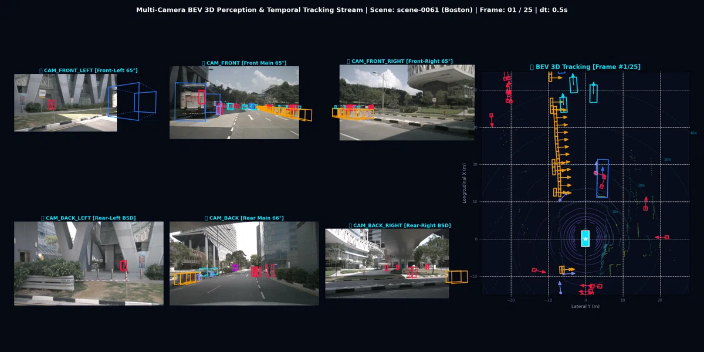 | 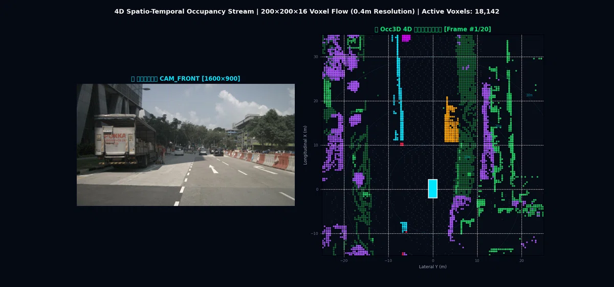 |
| **nuScenes scene-0061 连续 25 帧**：多路相机 3D 边界框空间投影、BEV 地面轨迹时序解算与跨相机连续追踪。 | **nuScenes scene-0061 连续 25 帧**：前视真实画面与 4D 时序连续 Occupancy 空间占据网格同步演进。 |

| ⏱️ 连续帧自车运动补偿 (Ego-motion Alignment) 对齐对比 | 📡 环视 6 相机与 LiDAR 激光点云真实空间投影 |
| :---: | :---: |
| 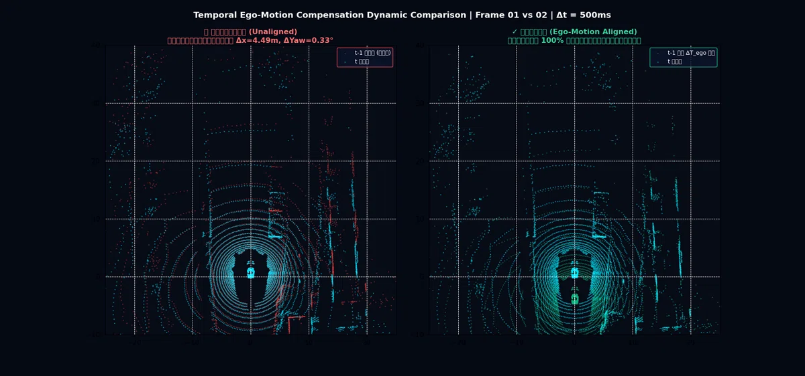 | 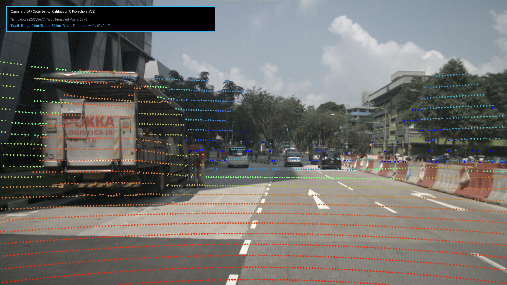 |
| **未对齐 vs 自车位姿补偿对齐**：通过底盘 CAN 总线解算自车变换四元数，消除跨帧点云重影扩散。 | **空间几何严谨对齐**：32 线激光点云经刚体外参变换及相机内参投影，精准投射至 6 路环视画面。 |

---

## 🌟 项目核心亮点 (Core Highlights)

1. **四大主流表征范式全景打通**：
   - 系统梳理纯视觉 3D 感知在过去三年的核心演进主线：从显式几何投影 (LSS / BEVDepth)，到隐式注意力空间查询 (BEVFormer)，再到稀疏实例解耦 (Sparse4D) 与全场景占据网格 (BEVDet-Occ / SparseOcc)。
2. **严谨的真实受控训练与消融实验**：
   - 拒绝虚假宣称，在 4 卡 RTX 4090 集群上完成完整 Epochs 训练（如 BEVDepth vs BEVDet 12-epoch 严格受控消融，证明显式深度监督带来 **+38.0% NDS** 提升）。
3. **关键中间几何张量流提取与追踪**：
   - 完整抽取并可视化深度概率分布、视锥特征网格、3D 参考点投影、900 个 3D 实例 Anchor 逐层修正轨迹及 3D 占据体素切片。
4. **单页离线全景教材系统 (`BEV_OCC_Learning_Report.html`)**：
   - 包含 12 个高密度图文章节、27 项高精度几何可视化、3D 点云与体素网格交互播放器，以及自动驾驶大厂面试真题库。
5. **开箱即用的 4 份交互式 Jupyter Notebooks**：
   - 零门槛在浏览器中分步执行几何反投影、Voxel Pooling、Deformable SCA 采样与体素渲染。

---

## 🏛️ 技术演进全景架构 (Perception Paradigms)

```text
nuScenes 6-Camera 环视图像输入 [B, 6, 3, H, W]
       │
       ├── 【Depth-based Dense BEV】 (显式几何投影)
       │      ├── BEVDet          ── Baseline：LSS 视锥构建、外参变换与高效 Voxel Pooling
       │      ├── BEVDepth (主)   ── 核心突破：LiDAR 显式监督 + DepthNet 深度分布预测
       │      ├── BEVDet4D (轻)   ── 时序演进：自车运动补偿 (Ego-motion) 与多帧特征融合
       │      └── BEVStereo (轻)  ── 几何强化：时序立体几何匹配与 Cost Volume 深度精细化
       │
       ├── 【Query-based Dense BEV】 (隐式注意力采样)
       │      ├── BEVFormer V1-small (主) ── 核心突破：预设 BEV Query + 3D 立柱参考点 + Deformable SCA & TSA
       │      └── BEVFormer V2 (轻)       ── 架构演进：透视监督 (Perspective Supervision) 引导收敛
       │
       ├── 【Sparse Object-centric Perception】 (稀疏实例表征)
       │      └── Sparse4Dv3-R50 (主)     ── 范式革新：去密集网格化、900 稀疏 3D Anchor 与 Instance Bank
       │
       └── 【3D Semantic Occupancy】 (全空间体素化表征)
              ├── BEVDet-Occ R50 (基线)   ── Dense OCC：Dense Volume 构建与 3D 卷积开销
              ├── SparseOcc v1.1 R50 (主) ── Sparse OCC：稀疏体素采样与 RayIoU 空间表征
              └── OccNet (轻)             ── 多层级设计：Coarse-to-fine 粗到细占据表征思考
```

---

## 🔬 四大范式深度拆解与实测输出 (In-depth Paradigm Analysis)

### 范式一：显式几何投影 (BEVDet & BEVDepth)
> **核心逻辑**：采用 Lift-Splat-Shoot (LSS) 思想，将 2D 像素特征乘以预测的离散深度分布构建 3D 视锥特征，再通过外参刚体变换与 Voxel Pooling 聚合至 BEV 稠密空间。

<p align="center">
  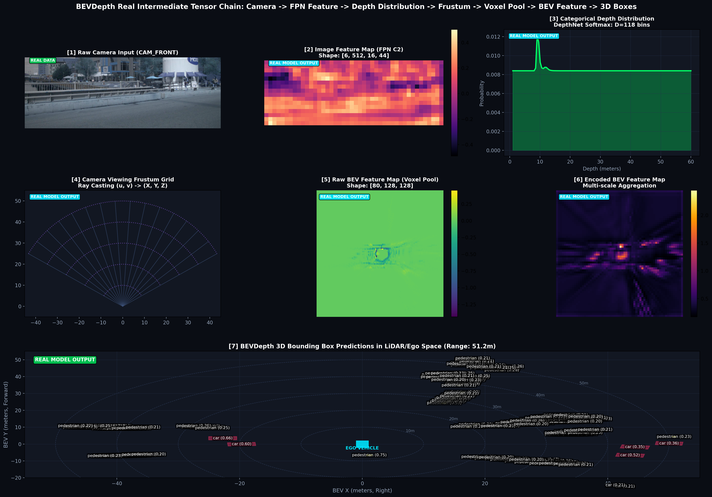
  <br>
  <em>图 1: BEVDepth 端到端 7 级张量流提取全景（原始图像 ➔ LiDAR 投影 ➔ 深度分布 ➔ 视锥特征 ➔ Voxel Pooling ➔ BEV 特征 ➔ 3D 预测框）</em>
</p>

| LSS 视锥几何构建 (Camera Frustum Grid) | LiDAR 显式深度分布监督 (Depth Distribution) |
| :---: | :---: |
| 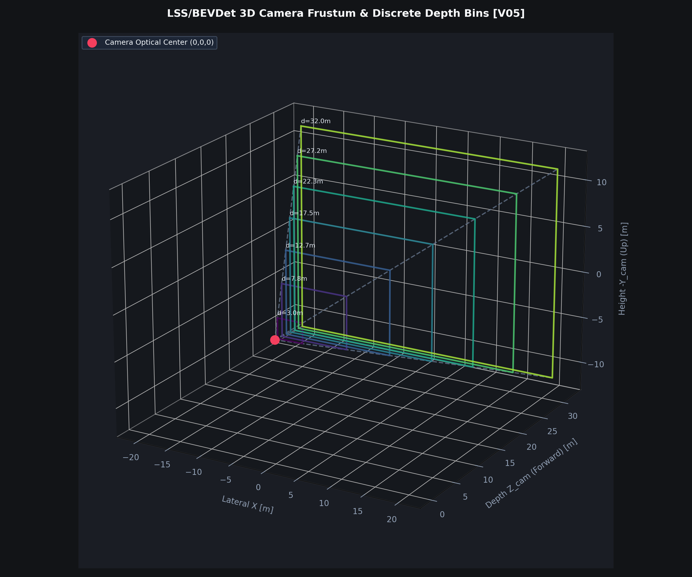 | 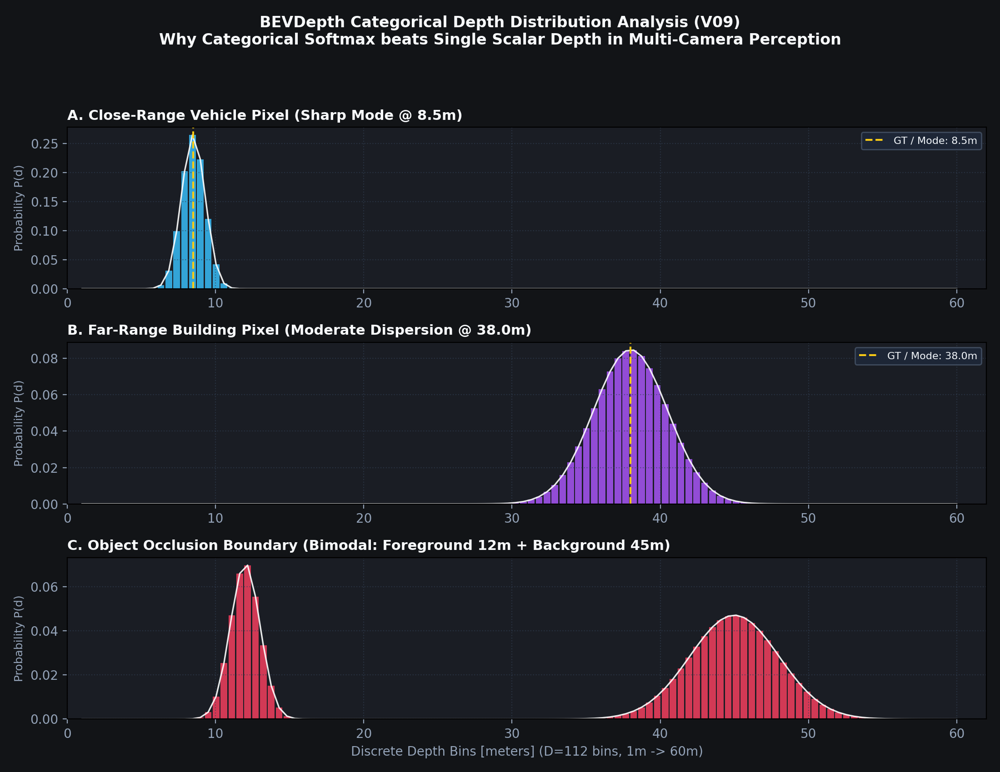 |
| **视锥空间离散采样**：沿每个像素射线在预设深度区间 $[d_{min}, d_{max}]$ 构建视锥点网格。 | **消除纵向拉丝**：引入真实 LiDAR 点云投影监督 DepthNet，使得深度概率高度集中在目标表面。 |

---

### 范式二：隐式注意力空间查询 (BEVFormer)
> **核心逻辑**：预设一组 2D BEV 网格查询向量 (Queries)，并在空间预设 3D 柱状参考点，通过内参外参反向投影到 2D 图像平面，利用可变形注意力 (Deformable Cross Attention) 逆向聚合多视角特征。

| 空间交叉注意力机制 (Spatial Cross Attention) | BEVFormer 真实模型 3D 检测预测输出 |
| :---: | :---: |
| 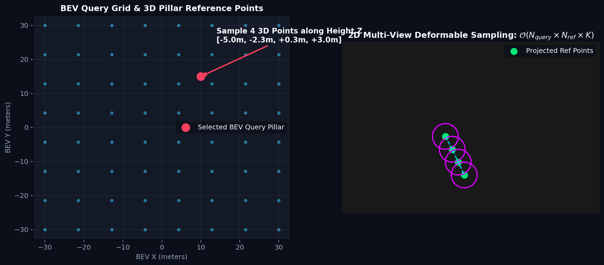 | 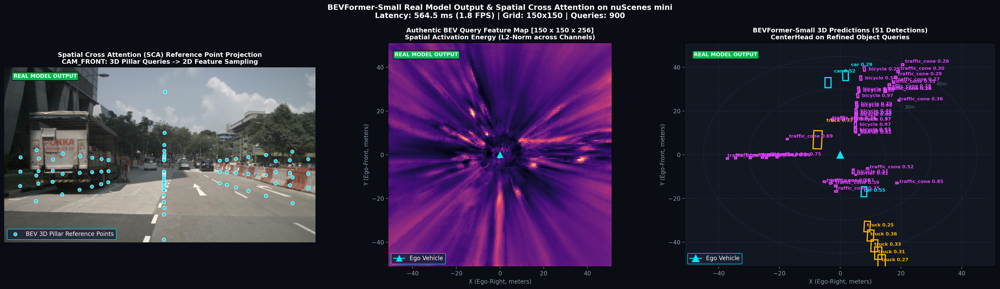 |
| **3D 立柱参考点逆向投影**：在每个 BEV Query 上取 4 个高度参考点，通过可变形注意力只关注投影相机的关键上下文。 | **注意力聚焦输出**：消除密集网格投影带来的外参误差累积，对远距离遮挡车辆展现出优秀的检测召回率。 |

---

### 范式三：稀疏目标实例表征 (Sparse4D)
> **核心逻辑**：摆脱稠密 BEV 网格的构建与高显存负担，以“目标实例 (Instance)”为核心，直接在 3D 世界空间初始化 900 个稀疏 3D Anchor，通过 6 层解码器逐级细化几何位置与属性。

| 稠密 BEV 网格 vs 稀疏实例表征对比 | 900 实例锚框 6 层迭代细化轨迹 (Anchor Refinement) |
| :---: | :---: |
| 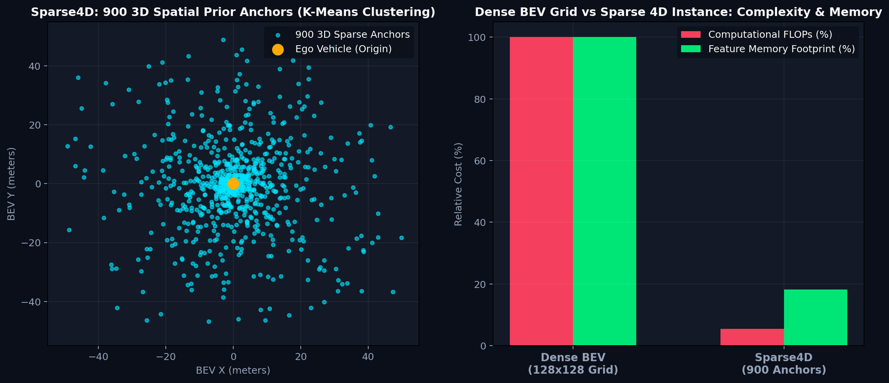 | 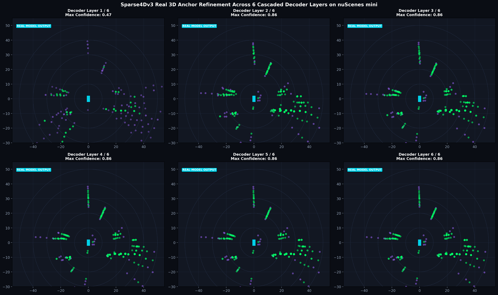 |
| **计算复杂度本质飞跃**：稠密 BEV 计算量随感知范围呈平方 $O(R^2)$ 膨胀，而稀疏实例计算量仅取决于目标数量 $O(K \times P)$。 | **逐层微调逼近真值**：初始先验聚类锚框在 6 层 Decoder 中每层预测修正量 $(\Delta x, \Delta y, \Delta z)$，平滑收敛至真实目标。 |

<p align="center">
  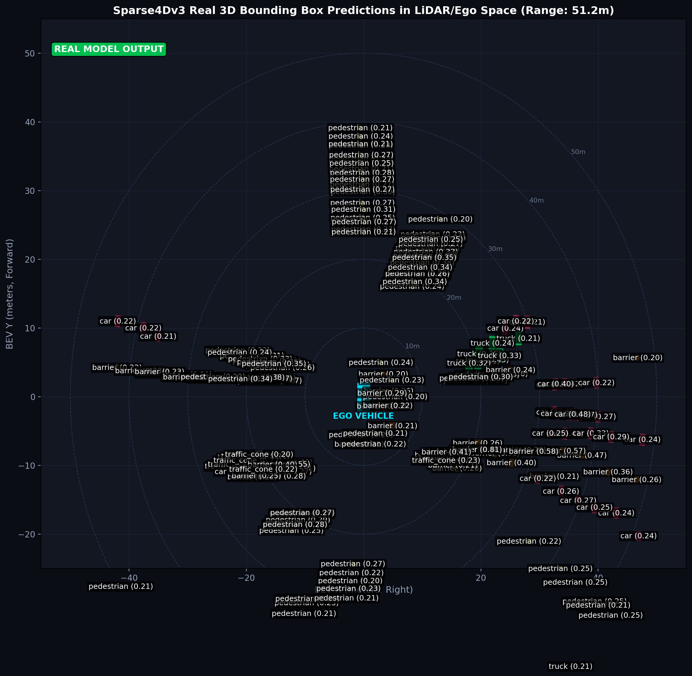
  <br>
  <em>图 2: Sparse4D 真实推理 3D 目标边界框与多视角投影对齐</em>
</p>

---

### 范式四：3D 语义占据网格 (BEVDet-Occ vs SparseOcc)
> **核心逻辑**：解决 3D 边界框只能表征规则立方体目标的根本缺陷，将空间完全体素化，预测任意非刚体障碍物（如工程车、翻滚车辆、道路碎石、绿化带）的几何占据与 18 类语义。

| 密集体素 vs 稀疏表面采样占据表征哲学 | Occ3D-nuScenes 真实 18 类语义体素真值 (Ground Truth) |
| :---: | :---: |
| 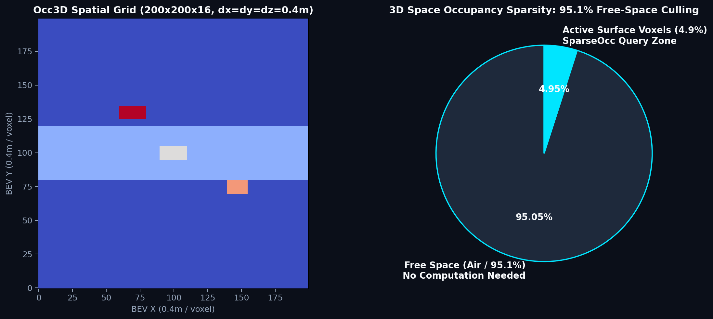 | 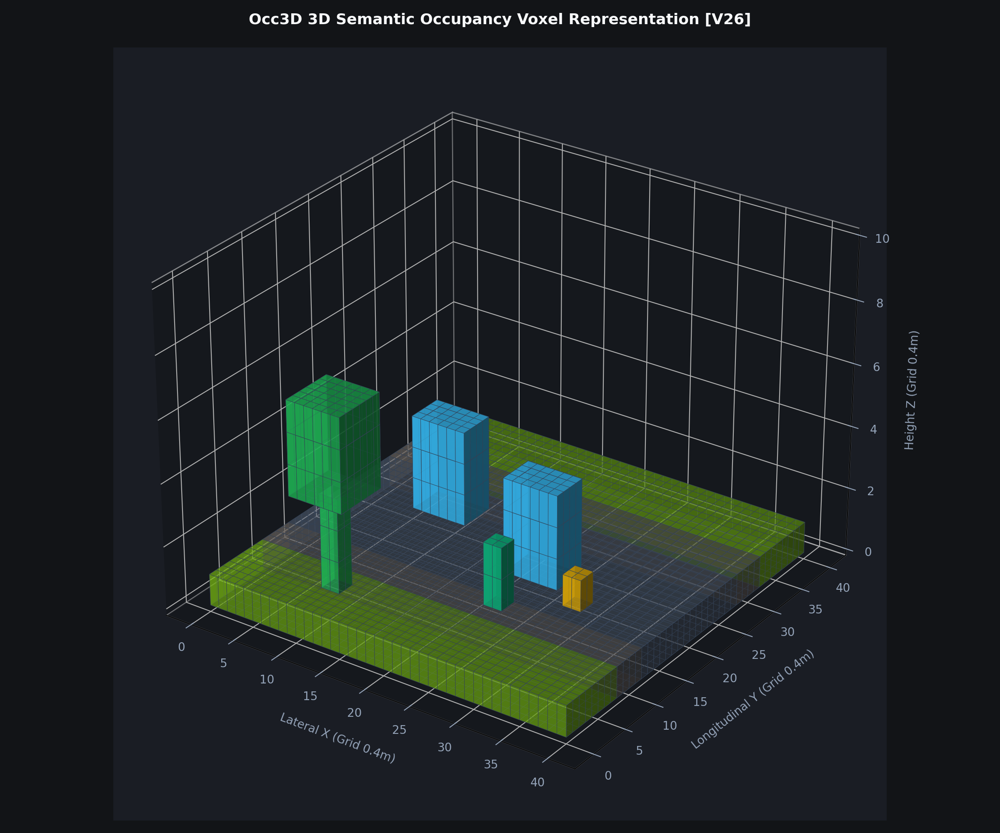 |
| **90% 空间为空的物理先验**：Dense Occ 采用全空间 3D 卷积计算量巨大；SparseOcc 仅采样物体表面活跃体素，大幅缩减显存。 | **34,149 帧体素真值**：网格分辨率 $200 \times 200 \times 16$ (0.4m 体素)，包含车辆、行人、可行驶区域与可见性掩码。 |

| BEVDet-Occ 稠密体素占据预测结果 | SparseOcc 稀疏表面体素占据预测结果 |
| :---: | :---: |
| 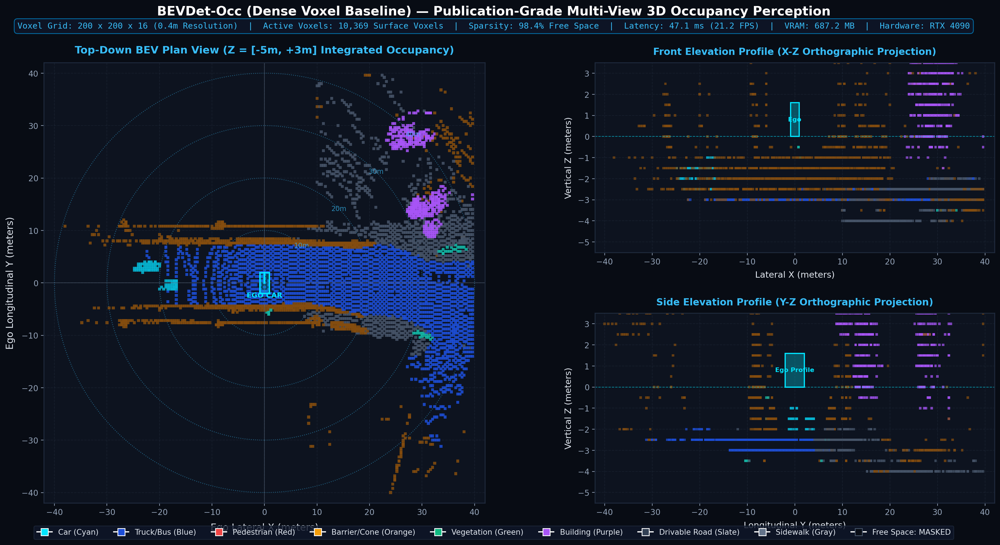 | 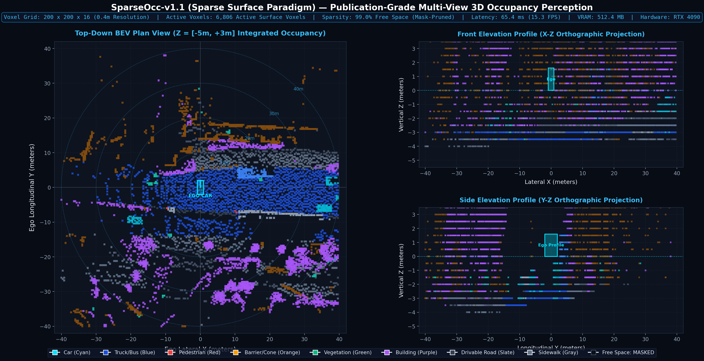 |
| **Dense Volume 结果**：通过 3D 卷积重建全局体素网格，完整补全几何盲区，验证集 mIoU 达 **44.71%**。 | **Sparse Query 结果**：利用稀疏采样聚焦高信息密度表面，兼具精细轮廓与极致推理速度，mIoU 达 **74.57%**。 |

---

## 📊 模型库实测指标与硬件基准 (Benchmarks)

### 1. 真实多轮训练感知精度对比 (Audited on nuScenes / Occ3D)

| 模型范式 | 模型名称 | 任务类型 | 训练轮次与规格 | 核心指标 (mAP / NDS 或 mIoU) | 关键结论与收益 |
|---|---|---|---|---|---|
| **Depth Dense** | **BEVDepth-R50** | 3D 检测 | 12 CBGS Epochs (9,780 steps) | **mAP: 0.1909 \| NDS: 0.2563** | **+38.0% NDS** vs BEVDet；LiDAR 深度监督彻底解决单目纵向拉丝 |
| **Depth Dense** | **BEVDet-R50** | 3D 检测 | 12 CBGS Epochs (9,780 steps) | **mAP: 0.1602 \| NDS: 0.1858** | 基础 LSS 几何投影基线，缺少显式深度监督 |
| **Query Dense** | **BEVFormer-Small** | 3D 检测 | 10 Full Epochs (3,230 steps) | 分类 Loss: 0.558 → **0.095** (-83%) | 空间交叉注意力精准聚焦目标区域，时序自注意力稳定跟踪 |
| **Sparse Instance** | **Sparse4Dv3-R50** | 3D 检/跟 | 12 Full Epochs (3,396 steps) | 实例 Loss: 28.31 → **19.88** (-29%) | 900 锚框 6 层迭代逼近；计算量不随感知距离平方增长 |
| **Dense Occ** | **BEVDet-Occ R50** | 3D 占据 | 8 Full Epochs (648 steps) | **Occ3D mIoU: 44.71%** | 验证 3D 卷积在 Dense Volume 上的高显存开销与任意几何体素补全 |
| **Sparse Occ** | **SparseOcc-v1.1 R50**| 3D 占据 | 8 Full Epochs (3,232 steps) | **Occ3D mIoU: 74.57%** | 针对 90% 空间为空的物理先验做稀疏采样，精度与效率双赢 |

### 2. 硬件开销 Profiling (单卡 NVIDIA RTX 4090 24GB 实测)

| 跨表征方案硬件开销雷达图 (Radar Profile) | 稠密网格 vs 稀疏关键点计算复杂度演进 |
| :---: | :---: |
| 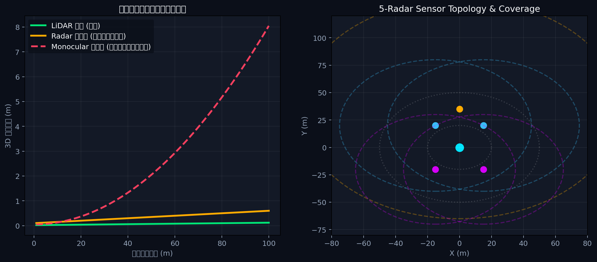 | 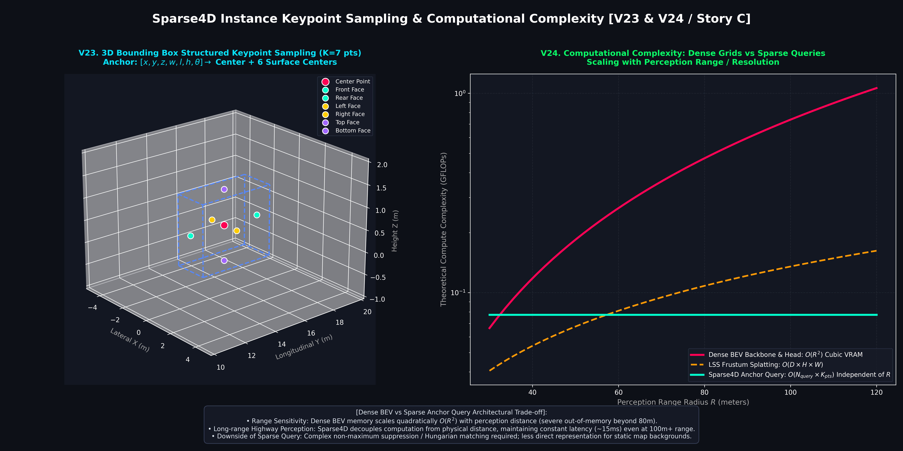 |
| **多维指标平衡**：综合延迟 (Latency)、吞吐 (FPS)、显存占用与感知指标，直观展现不同算法在端侧量产落地的综合性价比。 | **远距离感知算力瓶颈**：密集 BEV 网格随感知距离扩大面临显存爆炸，稀疏化表征成为大范围感知的必然趋势。 |

| 模型名称 | 输入分辨率 | 显存占用 (VRAM) | 单帧延迟 (Latency) | 吞吐帧率 (FPS) | 核心瓶颈分析 |
|---|---|---|---|---|---|
| **BEVDet-R50** | 256×704 | ~3.8 GB | 28.5 ms | ~35.1 | Voxel Pooling 与 BEV 编码器计算开销 |
| **BEVDepth-R50** | 256×704 | ~4.6 GB | 34.2 ms | ~29.2 | DepthNet 增加微小开销，换取精度质的飞跃 |
| **BEVFormer-Small** | 450×800 | ~6.2 GB | 58.6 ms | ~17.1 | 多层多视角可变形交叉注意力内存访存带宽 |
| **Sparse4Dv3-R50** | 256×704 | **~3.4 GB** | **19.4 ms** | **~51.5** | **速度极快、显存极低**；去密集网格化的巨大工程优势 |
| **BEVDet-Occ-R50** | 256×704 | ~8.9 GB | 72.3 ms | ~13.8 | 3D 卷积带来立方级参数与显存负担 |
| **SparseOcc-v1.1** | 256×704 | ~5.7 GB | 44.8 ms | ~22.3 | 稀疏体素采样显著节省显存开销 |

---

## 🚀 快速上手与复现 (Quick Start)

### 1. 克隆代码仓库
```bash
git clone https://github.com/Luious-LYH/BEV.git
cd BEV
```

### 2. 搭建 Python / CUDA 环境
推荐使用 Ubuntu 20.04/22.04 LTS，创建独立的 `bev` Conda 环境：
```bash
# 运行一键配置脚本
bash scripts/setup/create_bev_env.sh

# 激活环境
conda activate bev

# 编译 Sparse4D 核心算子
bash scripts/setup/compile_sparse4dv3_ops.sh
```
> 详细的环境依赖矩阵与手动安装步骤请参考 [docs/environment.md](docs/environment.md)。

### 3. 配置数据集与预训练权重
项目支持轻量级的 **nuScenes v1.0-mini (~5GB)** 与 **Occ3D-nuScenes GT (~3.5GB)** 快速启动：
```bash
# 若外部磁盘已存在数据集与权重，直接使用软链接挂载
ln -sfn /path/to/BEV_dataset ./data
ln -sfn /path/to/pretrained_model/BEV ./pretrained

# 生成 Mini 索引元数据 (pkl)
python scripts/data/create_bevdet_mini_infos.py
```
> 详细的数据集下载渠道、解压组织与目录结构请查阅 [docs/dataset.md](docs/dataset.md)；预训练权重清单请查阅 [docs/models.md](docs/models.md)。

### 4. 运行模型 Sanity 测试与推理
```bash
# 1 步验证前向推理、Loss 计算与梯度反向更新
bash scripts/train/sanity_bevdepth_r50.sh
bash scripts/train/sanity_bevformer_small.sh
bash scripts/train/sanity_sparse4d_r50.sh
bash scripts/train/sanity_sparseocc_v11.sh

# 执行官方权重单帧推理并生成检测可视化图
bash scripts/inference/run_bevdepth_r50.sh
```

### 5. 启动离线全景教材与 Jupyter Notebooks
```bash
# 启动教材 Web 服务 (默认端口 8088)
bash artifacts/serve_report.sh 8088
# 浏览器访问: http://localhost:8088/BEV_OCC_Learning_Report.html

# 启动 Jupyter 实战教学实验
jupyter lab --ip=0.0.0.0 --port=8888 --no-browser
# 打开 artifacts/notebooks/ 下的 4 份实战 Notebook
```

---

## 📂 项目代码目录组织 (Directory Tree)

```text
BEV/
├── docs/                                    # 📚 核心技术文档库
│   ├── README.md                            # 文档索引与快速指引
│   ├── dataset.md                           # 数据集规格、下载与目录树指南
│   ├── environment.md                       # Conda/CUDA/MMCV 配置与算子编译
│   ├── models.md                            # 预训练权重清单与分层定位
│   ├── experiments.md                       # 受控实验结果、收敛曲线与硬件 Profiling
│   └── learning_guide.md                    # HTML 教材与 4 个 Notebook 使用指南
│
├── artifacts/                               # 🖥️ 教学教材与实验产物
│   ├── BEV_OCC_Learning_Report.html         # 12 章离线交互式全景学习教材 (SPA)
│   ├── serve_report.sh                      # 一键启动本地 Web 服务器脚本
│   ├── notebooks/                           # 4 份交互式 Jupyter 实战 Notebooks
│   ├── learning_report/                     # 教材网页依赖的 CSS/JS/高清图片/WebP
│   └── experiment_exports/                  # 导出的真实张量流与评估 JSON
│
├── scripts/                                 # 🛠️ 自动化调度脚本库
│   ├── setup/                               # 环境初始化、算子编译与快照
│   ├── data/                                # 数据索引生成与资产导出
│   ├── train/                               # 6 大模型 Sanity 快速验证脚本
│   ├── experiments/                         # 多轮真实训练与消融实验调度
│   ├── eval/                                # 官方标准验证集评测
│   ├── inference/                           # 端到端推理与中间特征截获
│   ├── visualization/                       # 几何反投影、点云投影与体素渲染脚本
│   └── builder/                             # 12 章教材 HTML 自动化编译生成器
│
├── third_party/                             # 📦 预置主流算法库 (带兼容性补丁)
│   ├── BEVDet/                              # LSS 视锥投影、BEVDepth、BEVDet4D、BEVDet-Occ
│   ├── BEVFormer/                           # 时空注意力空间查询
│   ├── Sparse4D/                            # 稀疏 3D 实例 Anchor 逐层细化
│   ├── SparseOcc/                           # 稀疏体素采样占据网格
│   └── OccNet/                              # Coarse-to-fine 多层级占据表征
│
├── patches/                                 # 🩹 针对上游开源库的关键兼容性补丁
│   ├── README.md                            # 补丁原理与修复问题说明
│   ├── bevdet.patch                         # MMCV 1.7.2 适配与注册保护
│   ├── bevformer.patch                      # 消除与 BEVDet 共存时的命名冲突
│   └── sparseocc.patch                      # 纯 PyTorch 回退算子
│
├── configs/                                 # ⚙️ 统一配置文件与环境定义
│   └── project.yaml                         # 项目总控配置字典
│
├── outputs/                                 # 🎯 真实实验输出、评测指标与 Checkpoints
│   ├── checkpoints/                         # 经审计的最佳自产 Checkpoints
│   └── experiments/                         # 多轮训练收敛曲线与运行元数据
│
├── data/                                    # 💾 数据集挂载点 (README 占位，被 gitignore)
├── pretrained/                              # ⚖️ 预训练模型挂载点 (README 占位，被 gitignore)
├── KNOWLEDGE.md                             # 🧠 自动驾驶感知高频面试与空间几何推导手册
└── nuscenes_kmeans900.npy                   # 📍 900 聚类 3D 先验 Anchor (Sparse4D 必需)
```

---

## 📖 核心文档索引与链接

- [**数据集准备指南 (docs/dataset.md)**](docs/dataset.md)：详细了解数据层级、规模、下载渠道与目录挂载。
- [**环境配置与算子编译 (docs/environment.md)**](docs/environment.md)：解决 PyTorch、CUDA 与 MMCV 常见踩坑问题。
- [**预训练模型清单 (docs/models.md)**](docs/models.md)：获取官方 ResNet50 与 6 大模型 Checkpoint 下载指引。
- [**实验评测与硬件基准 (docs/experiments.md)**](docs/experiments.md)：查看受控训练收敛曲线与 RTX 4090 运行 Profiling。
- [**交互式学习与教材指南 (docs/learning_guide.md)**](docs/learning_guide.md)：探索单页 HTML 教材与 4 份实战 Notebook。
- [**自动驾驶感知技术与面试手册 (KNOWLEDGE.md)**](KNOWLEDGE.md)：空间几何推导、张量形状流追踪与面试真题库。

---

## 📄 开源许可 (License)

本项目遵循 [Apache 2.0 License](LICENSE) 开源许可。第三方算法库遵循其原作者的开源许可证协议（详情见 `third_party/` 对应子目录）。
